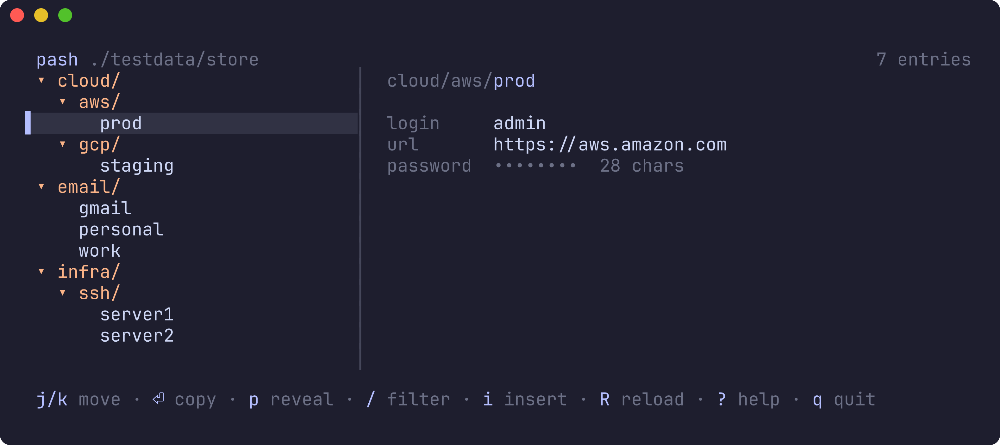

# pash

A keyboard-first TUI for browsing, searching, previewing, and transient-copying
entries from a [`pass`](https://www.passwordstore.org/) (Unix password store)
tree. Wraps your existing `passc` + `tc` pipeline so copied secrets never land
in Raycast / Maccy / Flycut clipboard history.



While filtering (`/`), the tree becomes a ranked list of matching entry paths
with the matched characters highlighted.

## Install

```sh
npm install -g @mifwar/pash
```

## Usage

```sh
pash                 # open the TUI against $PASSWORD_STORE_DIR ?? ~/.password-store
pash --store ~/work  # one-shot store override (or: pash ~/work)
pash --help          # full key reference
```

### Key bindings

| Key                          | Action                                         |
| ---------------------------- | ---------------------------------------------- |
| `j` / `k`                    | Move selection                                 |
| `g` / `G`                    | Top / bottom                                   |
| `Ctrl-d` / `Ctrl-u`          | Half page down / up                            |
| `h` / `←`                    | Collapse group / jump to parent                |
| `l` / `→` / Enter (on group) | Expand group                                   |
| `Enter` (on entry)           | Transient-copy password via `passc`            |
| `p`                          | Toggle full-body preview (plaintext on screen) |
| `/`                          | Filter (fuzzy; `↑`/`↓` or `Ctrl-n/p` to move)  |
| `i`                          | Insert new entry (`pass generate`)             |
| `Esc`                        | Hide preview / clear filter / cancel           |
| `R`                          | Reload store from disk                         |
| `?`                          | Toggle full help                               |
| `q` / `Ctrl-c`               | Quit                                           |

### Security

The right pane shows **non-secret frontmatter only** by default
(login, url, email, otpauth, notes). The password is masked as
`••••••••  N chars`. Hit `p` to reveal — the pane divider turns red
while plaintext is on screen. Moving to another entry hides it again.

The metadata-only default means you can browse, disambiguate, and
copy without ever exposing a secret to your terminal. `Enter` is the
safe default; `p` is the explicit "show me" gate.

## Development

```sh
npm run demo   # fixture store, fake pass/passc
npm run dev    # your real store
npm test
```

## Configuration

`~/.config/pash/config.toml` is honored in v0.2. v0.1 reads:

- `$PASH_PASSC` — override the `passc` binary path (test hook)
- `$PASH_PASS` — override the `pass` binary path (test hook)
- `$PASSWORD_STORE_DIR` — standard `pass` env var

## Why

The existing flow is `passc email/gmail` — type the full path every time, no
search, no preview, no OTP, no generation. `pash` is the missing desktop
front-end and plugs straight into the transient-copy infra so secrets don't
leak into clipboard history.

## License

MIT
